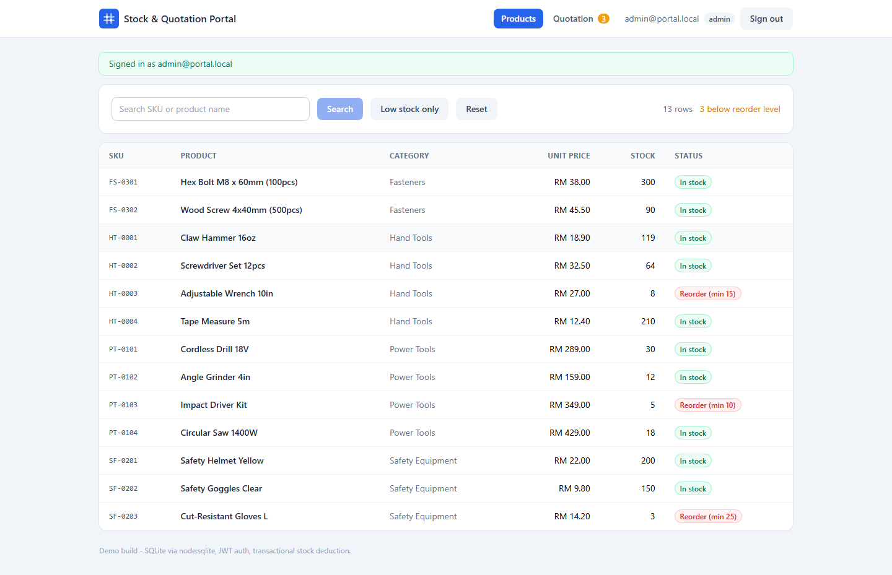
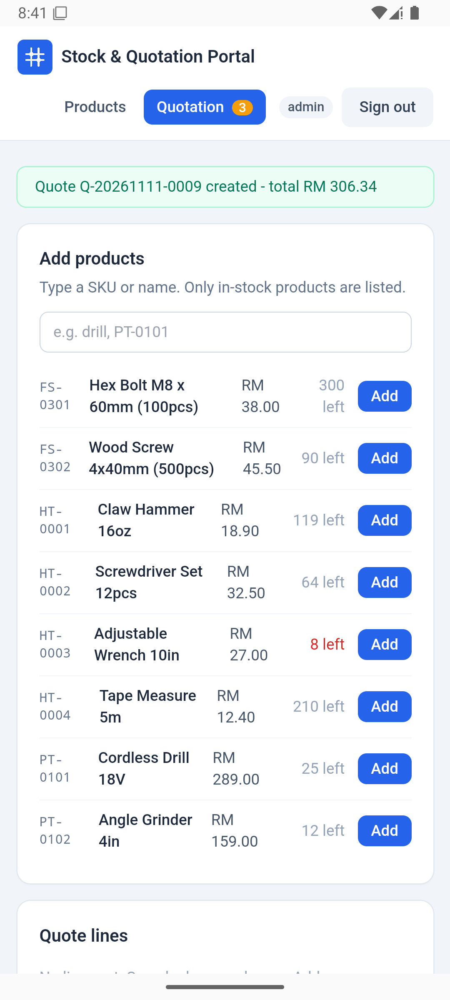
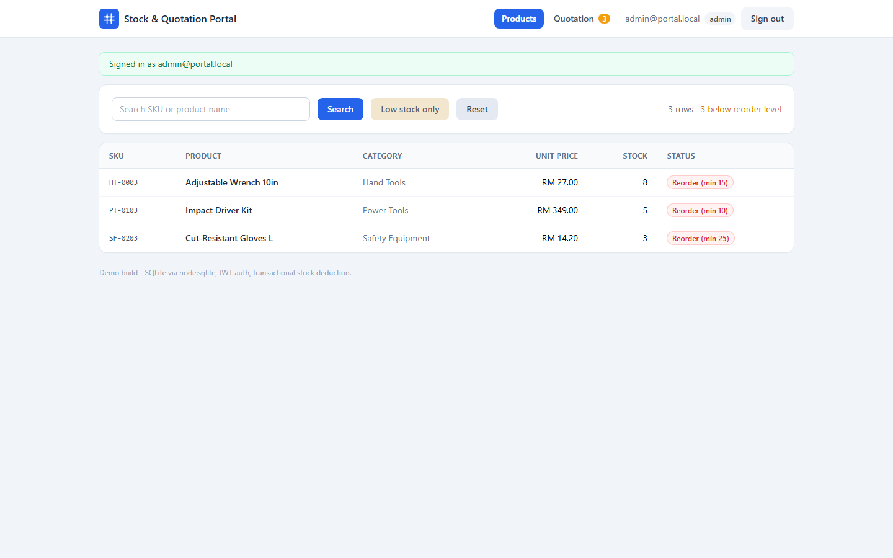
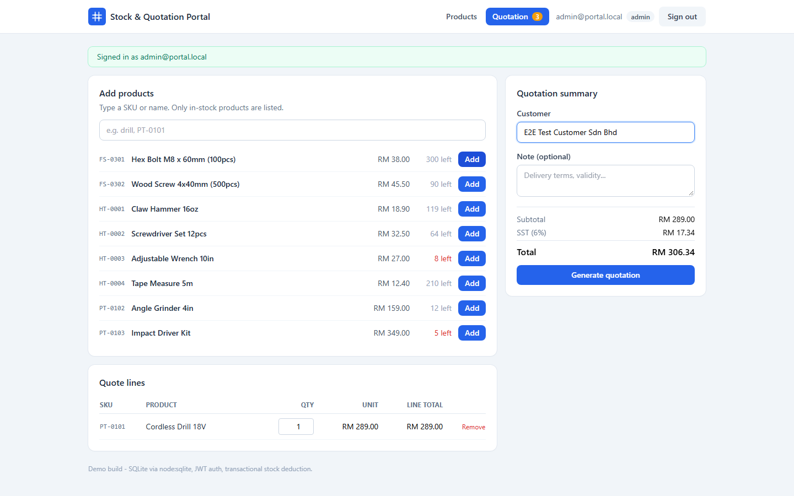
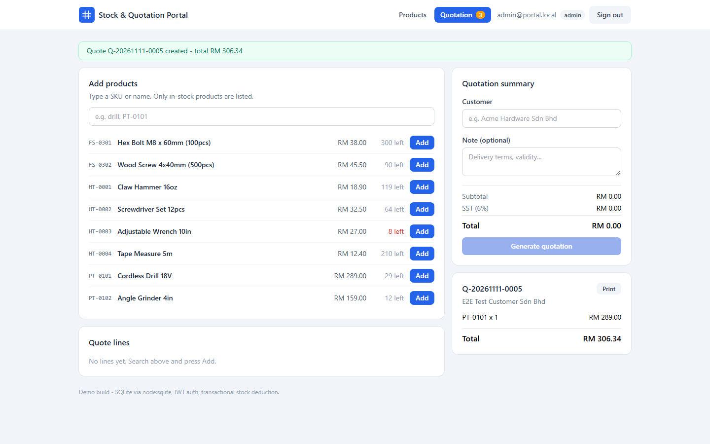
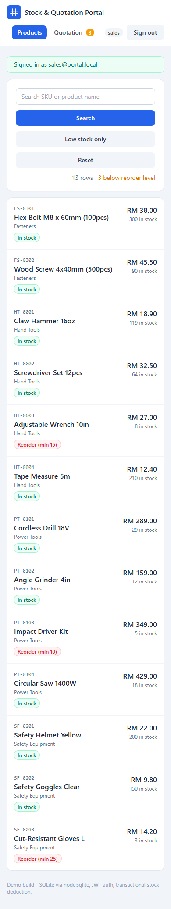

# Stock & Quotation Portal

A full-stack inventory and quotation system for a hardware distributor, plus a
companion webhook-to-messaging bot. Built as a portfolio project: every layer is
runnable from a clean checkout with one `npm install` per package.



## What it does

- **Product catalog** with SKU / name search, low-stock filtering, sortable columns.
- **Quotation builder** that prices a basket, applies 6% SST, and writes a numbered
  quotation in a single database transaction.
- **Stock deduction with row-level safety**: if any line cannot be fulfilled, the
  whole transaction rolls back and no stock is lost.
- **JWT authentication** with bcrypt-hashed passwords and role separation.
- **Responsive + installable** front-end: a data table on desktop, a card list on
  mobile, and a PWA manifest so it can be added to a phone home screen.
- **Native Android APK** built from the same Vue bundle through Capacitor - installs
  and runs on a phone without a browser.
- **Messaging bot** that receives a WhatsApp-style webhook, acks in under 60 ms, and
  dispatches outbound replies through a queue with exponential backoff.

## Install the Android app

**[⬇ Download StockPortal-1.2.apk](https://github.com/123haiku/stock-portal/releases/download/v1.2.0/StockPortal-1.2.apk)** (4.05 MB, signed
debug build, Android 7.0+)

The APK has no fixed server address: at startup it probes a short candidate list
and caches the first one whose `/api/health` answers. The public Cloudflare
hostname comes first, so the phone works on any network:

```
https://portal.ngc6543.tech/api   →  http://192.168.37.200:4000/api
                                 →  http://localhost:4000/api   (adb reverse)
                                 →  http://10.0.2.2:4000/api    (emulator)
```

The login screen shows the address in use and lets you change it without
rebuilding. Full instructions, including the Pi deployment and the tunnel
routing, are in [docs/ANDROID_APK.md](docs/ANDROID_APK.md).

## Where it runs

| Target | How |
| --- | --- |
| Public | `https://portal.ngc6543.tech/` and `/api/*` through Cloudflare Tunnel on the Pi |
| Laptop, development | `server` on `:4000`, `web` dev server on `:5173` with an `/api` proxy |
| Raspberry Pi (LAN) | systemd user units: API on `:4000`, prebuilt bundle on `:8088` (`deploy/pi-deploy.sh`) |
| Android phone | the APK above, resolving its API origin at runtime |



## Stack

| Layer | Choice | Why |
| --- | --- | --- |
| API | Node.js 24, `node:http` | No framework; routing is 40 lines of regex matching |
| Database | SQLite via `node:sqlite` | Zero external services, real SQL, real transactions |
| Auth | bcryptjs + HS256 JWT | Signed tokens with expiry, no session store to lose |
| Front-end | Vue 3 + Vite + Tailwind | Single-file components, scoped styles, fast HMR |
| Native shell | Capacitor 8 (Android) | Reuses the web build; no second UI codebase |
| Bot | Node.js, `node:http` + queue | Same runtime, independent process, separate port |

The database file is created and seeded on first start, so there is nothing to
provision.

## Quick start

Three terminals, one per process.

```bash
# 1. API on :4000
cd server
npm install
npm start

# 2. Front-end on :5173
cd web
npm install
npm run dev

# 3. Bot on :4010
cd bot
npm start
```

Open <http://localhost:5173> and sign in:

| Email | Password | Role |
| --- | --- | --- |
| `admin@portal.local` | `demo1234` | admin |
| `sales@portal.local` | `demo1234` | sales |

To start from a clean database: `cd server && npm run reset-db`.

## Screens

| Low-stock filter | Quotation builder |
| --- | --- |
|  |  |

| Generated quotation | Mobile (card layout) |
| --- | --- |
|  |  |

## Architecture

```
browser ──▶ Vite dev server :5173 ──/api proxy──▶ Express-style API :4000 ──▶ SQLite
                                                        │
WhatsApp Cloud API ──webhook──▶ bot :4010 ──queue──▶ transport (fake | cloud)
```

### Request flow for a quotation

1. The front-end posts `{ customerName, items[] }` with a bearer token.
2. The API verifies the JWT signature and expiry.
3. `BEGIN IMMEDIATE` opens a write transaction.
4. Each line is validated: product exists, quantity is a positive integer, and
   `stock <= available`. Any failure throws and the transaction rolls back.
5. The quotation number is derived from the row sequence inside the transaction,
   so concurrent requests cannot collide on the same number.
6. Line totals are summed, 6% SST applied, and `quotes` + `quote_items` written.
7. Stock is decremented per line, then `COMMIT`.

### Why the bot acks before it sends

A messaging platform retries any webhook that responds slowly or with a 5xx, which
turns a slow send into duplicate messages. The handler therefore returns `200`
immediately and pushes the send onto a queue. The queue retries with capped
exponential backoff (250 ms, 500 ms, 1 s, 2 s, ...) and dead-letters after five
attempts so a poison message cannot block the rest.

## API

All routes except `/api/health` and `/api/auth/login` require
`Authorization: Bearer <token>`.

| Method | Path | Purpose |
| --- | --- | --- |
| GET | `/api/health` | Liveness probe |
| POST | `/api/auth/login` | Exchange credentials for a JWT |
| GET | `/api/products?q=&lowStock=1&limit=` | Search catalog |
| GET | `/api/products/low-stock` | Products at or below reorder level |
| GET | `/api/quotes` | Latest 100 quotations |
| POST | `/api/quotes` | Create a quotation (transactional) |
| GET | `/api/quotes/:id` | Quotation with line items |

```bash
curl -s http://localhost:4000/api/health

TOKEN=$(curl -s -X POST http://localhost:4000/api/auth/login \
  -H 'Content-Type: application/json' \
  -d '{"email":"admin@portal.local","password":"demo1234"}' | jq -r .token)

curl -s "http://localhost:4000/api/products?q=drill" -H "Authorization: Bearer $TOKEN"
```

## Bot endpoints

| Method | Path | Purpose |
| --- | --- | --- |
| GET | `/webhook` | Subscription handshake (`hub.mode`, `hub.verify_token`, `hub.challenge`) |
| POST | `/webhook` | Inbound message events |
| GET | `/stats` | Queue depth and dead-letter count |
| GET | `/health` | Liveness probe |

```bash
# handshake
curl "http://localhost:4010/webhook?hub.mode=subscribe&hub.verify_token=local-dev-token&hub.challenge=42"

# inbound event (WhatsApp Cloud API shape)
curl -X POST http://localhost:4010/webhook -H 'Content-Type: application/json' -d '{
  "entry":[{"changes":[{"value":{"messages":[
    {"from":"60111222333","id":"wamid.1","type":"text","text":{"body":"order enquiry"}}
  ]}}]}]
}'

# burst of 8 events + queue settle report
cd bot && npm run simulate
```

### Transports

`TRANSPORT=fake` (default) logs outbound messages and fails a configurable share
of them so the retry path is observable offline. `TRANSPORT=cloud` posts to the
WhatsApp Cloud API and requires `WHATSAPP_TOKEN` and `WHATSAPP_PHONE_ID`.

```bash
FAKE_FAILURE_RATE=0.2 npm start   # guarantees retries in the log
```

## Tests

```bash
cd server && npm test         # 11 checks: auth, search, transaction, rollback, 404s
cd bot    && npm test         # 9 checks: handshake, async ack, retry, dead-letter, FIFO
cd e2e    && npm run smoke    # 13 browser checks (needs both servers running)
cd e2e    && npm run android  # 10 checks inside the installed APK via CDP
```

The browser run drives a real Chromium instance through login, search, low-stock
filtering, quotation creation, and the mobile card layout, then writes screenshots
to `docs/screens/`. Install once with `npm i -D playwright && npx playwright install chromium`.

The Android run attaches to the installed app's WebView over the DevTools protocol
and repeats the same flow against the native shell, asserting that the APK really
reaches the API rather than a bundled stub. See `docs/ANDROID_APK.md` for the
`adb forward` prerequisite.

## Environment variables

| Variable | Default | Used by |
| --- | --- | --- |
| `PORT` | `4000` / `4010` | server, bot |
| `JWT_SECRET` | `dev-secret-change-me` | server |
| `DB_PATH` | `server/data/portal.db` | server |
| `VITE_API_URL` | `/api` | web build (pin one API origin; when unset the APK probes at runtime) |
| `VERIFY_TOKEN` | `local-dev-token` | bot |
| `TRANSPORT` | `fake` | bot |
| `FAKE_FAILURE_RATE` | `0.15` | bot |
| `APP_SECRET` | unset | bot (enables `X-Hub-Signature-256` verification) |
| `WHATSAPP_TOKEN`, `WHATSAPP_PHONE_ID` | unset | bot, cloud transport only |

## Known limitations

- Search uses `LIKE '%term%'`, which cannot use a b-tree index. Fine at this data
  volume; a real deployment needs SQLite FTS5 or a search service.
- Tokens live in `localStorage`, which is readable by injected scripts. A production
  build should use an `httpOnly` cookie plus CSRF protection.
- The queue is in-memory: a process restart drops pending jobs. Redis or a durable
  table is the next step.
- No migration tool; `schema.sql` is idempotent and the seed only runs on an empty
  database.
- The APK is signed with the Android debug key and speaks plain HTTP to a LAN
  address. A release build needs a private keystore and a reachable HTTPS endpoint.

## License

MIT
